<a href="https://www.ragesh.in/">
  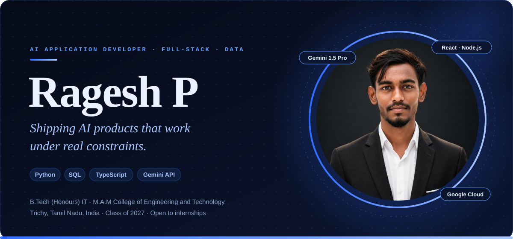
</a>

  
  
  
  

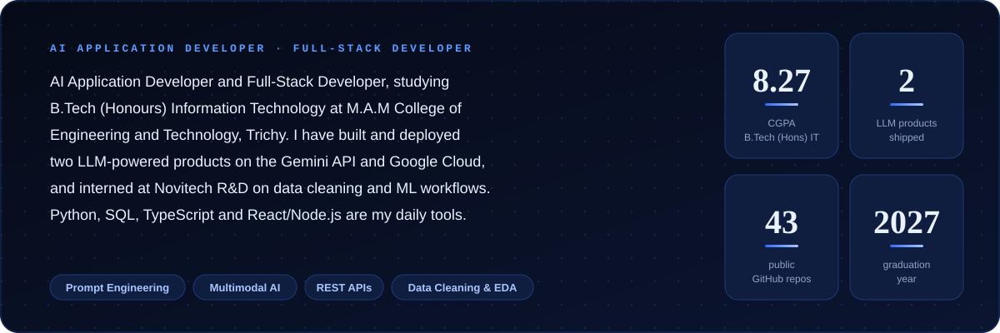


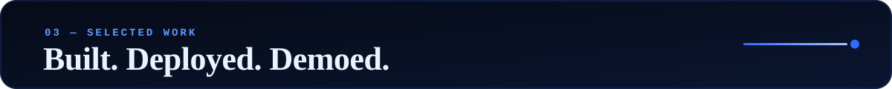

<a href="https://github.com/MrRagesh/SimplifyED">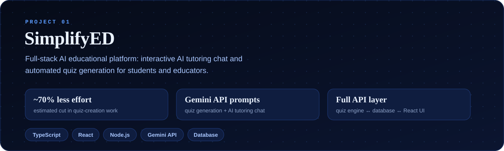</a>

  

<a href="https://github.com/MrRagesh/RescueLens-AI"></a>

  
  

<a href="https://github.com/MrRagesh/Personal-Portfolio-Website"></a>

  
  

<a href="https://www.ragesh.in/#portfolio">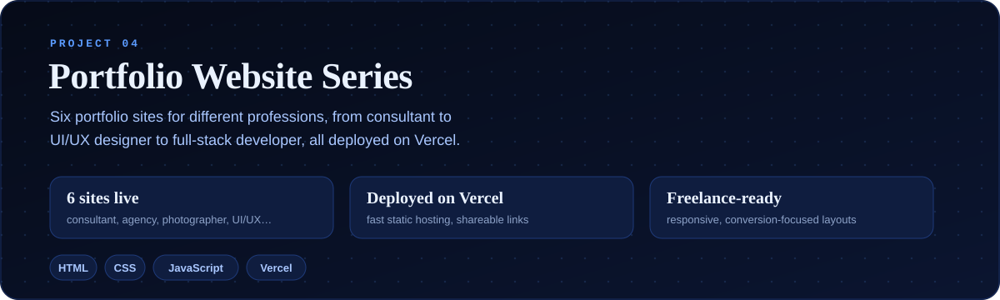</a>

  
  
  
  

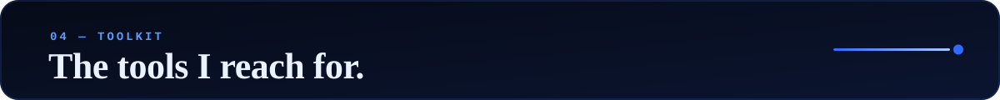


  
  

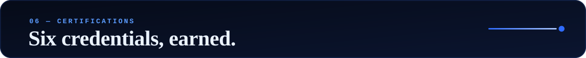


  
  
  
  

<a href="https://www.ragesh.in/">
  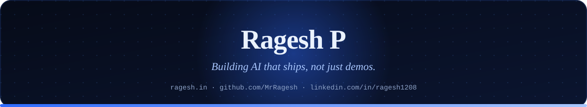
</a>
